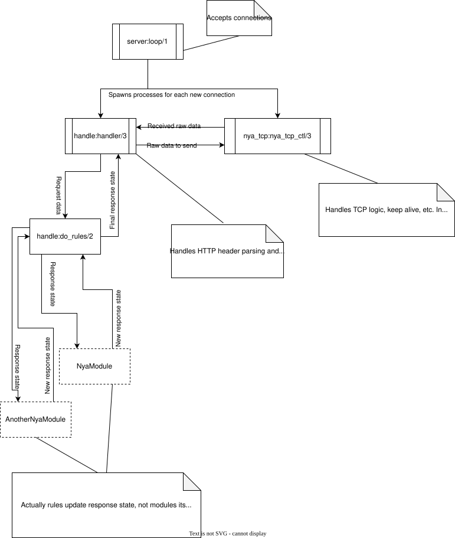
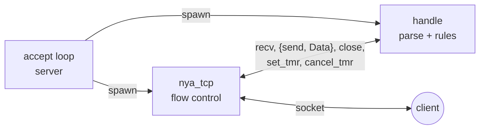

# Architecture

MeowMeow is a single OTP application (`app`) whose supervisor starts one
worker, `server:start/0`. Everything else is either a per-connection process
or a table in ETS.

## Startup

`server:start/0` runs these steps in order; a failure in any of them stops
the VM, so the server never runs with half a configuration.

1. **Configuration.** `configuration:load/0` parses `meow.conf` into a map, merged over the compiled-in defaults, and stores it in the `config_storage` ETS table. Every later lookup (`configuration:get/1,2`) reads that table.
2. **Rule tables.** `rules:init_rules/0` creates the `rules` and `rules_context` ETS tables, and `rules:register_basic/0` fills `rules` with `Abort`, `No-Content`, `Disallow`, `Set-Header` and `Set-Code`.
3. **Modules.** `nya_loader:nya_load_all/0` reads `LoadModules`, loads each module into the VM, checks that it declares the `nya_module` behaviour, calls its `init/0` and registers the directives returned by `get_custom_rules/0` (into `rules`) and `get_context_rules/0` (into `rules_context`).
4. **Routes.** `access:load_access/1` parses `routes.conf` into a nested list. A line whose directive is in `rules_context` becomes `{context, Name, Args, Block}` with the recursively parsed block; one whose directive is in `rules` becomes `{Name, Args}`; `Include` splices another file; anything else aborts startup. The result is stored in the `access` ETS table.
5. **Listen.** `server:listen_synchronized/1` opens a listening socket with the `socket` module (`reuseaddr`, `reuseport`, `nodelay`) on `ListenHost:ListenPort` and enters the accept loop in the calling process.

## Per-connection processes

Each accepted connection gets **two** processes:

`handle`
:   The middleware. It receives the raw request from the flow-control
    process, parses it (`parse_http`), validates it, evaluates the rules and
    builds the response. It never touches the socket for ordinary responses;
    it sends `{send, Data}` messages upstream.

`nya_tcp`
:   The flow-control process that owns the socket. It reads requests in
    64 KiB chunks and hands them to `handle`, writes whatever it is told to
    send, and runs the **keep-alive timer**: `set_tmr` arms it with the
    `KeepAlive` timeout, `cancel_tmr` disarms it (used while a file or an
    event stream is being sent), and when it fires the socket is closed and
    both processes end.

Because every connection is isolated in its own pair of lightweight
processes, a slow client, a large download or a long-lived event stream does
not affect any other connection.

## Life of a request

1. `nya_tcp` receives bytes and passes them to `handle`, which parses the request line, headers and, for requests with a body, checks `Content-Length` against `MaxPostSize`.
2. The HTTP version is checked against `AllowLegacyHttp`; HTTP/1.0 is answered with `505` when legacy HTTP is disabled.
3. `access:get_rules/1` evaluates the top-level context rules against the request and returns the rules whose conditions hold as one list; nested context blocks stay in it as `{context, Name, Args, Block}` entries. `rules:rulechain_exec/2` then walks that list with an initial response of `404 Not Found`:
    - for `{context, Name, Args, Block}` it calls the context function with `(Args, Request)`; if it returns `true` the block's rules are spliced in front of the remaining list;
    - for `{Name, Args}` it calls the rule function with `(Args, Response)` inside a `try`. A crash is logged and turned into `{aborted, 502}`.
4. The rule's return value drives the loop:

    | Return | Meaning | Loop |
    |--------|---------|------|
    | `{ok, Response}` | Response modified. | continues |
    | `{ready2send, Response}` | Response complete; `handle` serialises and sends it. | stops |
    | `{sent, Response}` | The rule already wrote everything to the socket (files, event streams). | stops |
    | `{aborted, Code}` | Send the standard error page for `Code`. | stops |

5. The response is written through `nya_tcp`, `Connection: keep-alive` is honoured unless the client asked to close, the keep-alive timer is re-armed and `handle` waits for the next request on the same connection.

## Static files

`static_handler` resolves the path under `DocDir` (falling back to
`index.html` for directories), stats it, sends the headers through `nya_tcp`
and then streams the body straight to the socket in `?chunk_size` (64 KiB)
pieces while the keep-alive timer is paused. It returns `{sent, Response}`.

## MCP sessions

The `mcp` module keeps a small process tree of its own:

- `mcp_port` owns the public `mcp_sessions` ETS table mapping session ids to `mcp_server` pids and generates the 64-byte session ids.
- `mcp_server` is a `gen_server` per session. It opens the tool with `open_port({spawn, Command}, [binary, {line, 65536}, use_stdio, exit_status])`, buffers partial lines, broadcasts each complete line to every connected handler process, and terminates itself when its `KEEPALIVE_MS` timer fires or the subprocess exits.
- The transport modules (`mcp_streamable`, `mcp_sse`, `mcp_single`) run inside the request's `handle` process. They connect to the session, write the request body to the subprocess, and either wait for the response with the matching JSON-RPC `id` or turn the connection into an event stream that forwards every broadcast line.

## Source map

| Path | Role |
|------|------|
| `src/app.erl`, `src/app_sup.erl` | OTP application and supervisor. |
| `src/server.erl` | Startup sequence, listening socket, accept loop. |
| `src/handle.erl` | Request validation, rule execution, response assembly. |
| `src/nya_tcp.erl` | Socket I/O and keep-alive timer per connection. |
| `src/parse_http.erl`, `src/response.erl` | HTTP parsing and serialisation. `request.hrl` and `response.hrl` define the records. |
| `src/configuration.erl` | `meow.conf` parsing and lookup. |
| `src/access.erl` | `routes.conf` parsing, `Include`, context evaluation. |
| `src/rules.erl` | Rule tables, basic rules, the evaluation loop. |
| `src/nya_module.erl`, `src/nya_loader.erl` | Module behaviour and loader. |
| `src/modules/*/` | Shipped modules. |
| `src/config.hrl` | Compile-time constants: file paths, defaults, chunk sizes, version string. |
| `src/logging.erl`, `src/util.erl` | Levelled coloured logging; wildcard, time and parsing helpers. |
